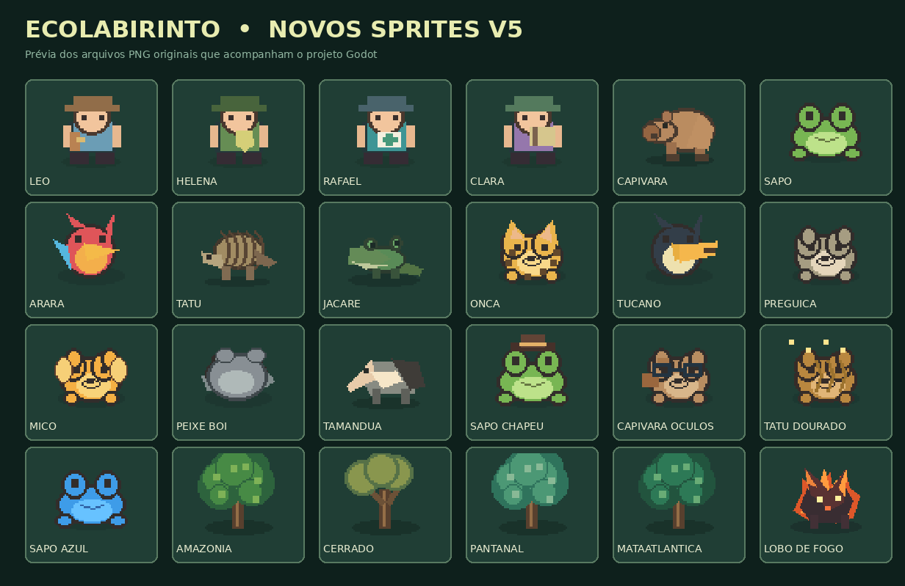

<div align="center">

# 🌿 EcoLabirinto
### GUARDIÕES DA FLORESTA

**Uma aventura brasileira em pixel art: explore, proteja e restaure a floresta.**

**Godot 4.7.2** · **2D top-down** · **Mapas por seed** · **Português (BR)** · **V7.1**



*Quatro guardiões. Quatro biomas. Uma floresta para salvar.*

</div>

---

> [!IMPORTANT]
> **Esta é a V7.1 do jogo.** A versão inclui correções de apresentação de textos no menu e mantém as melhorias de jogabilidade da V7. A validação por verificador estático **não substitui** executar o projeto no Godot 4.7.2.

## 🧭 Navegação rápida

| Quero… | Ir para… |
|:--|:--|
| 🎮 Começar a jogar | [Instalação e primeira partida](#instalacao) |
| ⌨️ Aprender os comandos | [Controles](#controles) |
| 🏕️ Conhecer os modos | [Modos de jogo](#modos) |
| 🔥 Enfrentar o chefe | [Lobo de Fogo](#lobo) |
| 🧬 Entender as seeds | [Seeds, coleção e recordes](#seeds) |
| 🛠️ Trabalhar no projeto | [Estrutura técnica](#arquitetura) |
| ✅ Fazer os testes | [Verificação e checklist](#checklist) |
| 🩹 Resolver problemas | [Solução de problemas](#problemas) |

---

## 🌳 Sobre o jogo

O **EcoLabirinto — Guardiões da Floresta** é um jogo de aventura **2D com visão de cima**, inspirado no espírito de exploração dos jogos clássicos. Não é um jogo de tabuleiro: o jogador se movimenta livremente por **labirintos gerados proceduralmente**, enfrenta ameaças ambientais e protege animais da fauna brasileira.

A proposta dialoga com a **ODS 15 — Vida Terrestre**. Cada partida coloca o jogador diante de um novo percurso, e o código da **seed** permite revisitar uma mesma configuração inicial dentro da mesma versão do gerador.

### O ciclo de uma partida

```text
ESCOLHER MODO + DIFICULDADE + GUARDIÃO
                   ↓
          DEFINIR OU GERAR SEED
                   ↓
          EXPLORAR O BIOMA
                   ↓
    RESGATAR • COLETAR • APAGAR FOGO
                   ↓
           CUMPRIR OBJETIVOS
                   ↓
           AVANÇAR / CONCLUIR
```

---

<a id="instalacao"></a>

## 🚀 Instalação e primeira partida

**Você precisa de:** Godot **4.7.2** e do projeto completamente descompactado.

1. **Extraia o ZIP**, mantendo a pasta `Eco/` e todas as subpastas.
2. Abra o **Gerenciador de Projetos** do Godot.
3. Escolha **Importar** e selecione `Eco/project.godot`.
4. Aguarde a importação inicial das imagens (`.png`) e dos sons (`.wav`).
5. Abra o projeto e pressione **F5** para executar.
6. No menu inicial, escolha **Começar aventura**, selecione o modo, a dificuldade e o guardião.

> [!TIP]
> **Primeira vez?** Comece no **Fácil**. Para testar o chefe sem atravessar a campanha, escolha **Contra o Relógio → Fase 5**.

### O que encontrar no menu

| Opção | Para que serve |
|:--|:--|
| **Começar aventura** | Iniciar uma partida, selecionar modo e personagem |
| **Como jogar** | Consultar instruções dentro do próprio jogo |
| **Bestiário e segredos** | Consultar espécies e descobertas opcionais |
| **Placar de recordes** | Ver resultados de partidas registrados localmente |
| **Configurações** | Ajustar apresentação e efeitos disponíveis |
| **Sair** | Fechar o jogo |

---

<a id="controles"></a>

## 🎮 Controles

| Tecla | Ação | Observações |
|:--:|:--|:--|
| `W A S D` ou `↑ ← ↓ →` | **Mover** | Movimento em quatro direções; diagonais normalizadas |
| `Shift` | **Correr** | Consome energia |
| `E` | **Interagir** | Resgatar animais, recolher itens, apagar incêndios e outras ações próximas |
| `Espaço` | **Poder especial** | Habilidade exclusiva do personagem; respeita a recarga |
| `Tab` | **Caderno** | Abre missões e informações detalhadas |
| `Esc` | **Pausar** | Abre o menu de pausa |

**Dica de leitura da HUD:** durante a exploração, a lateral prioriza barras, objetivos resumidos e o minimapa. As informações extensas ficam no **caderno** e nos menus, para não cobrir a ação.

---

<a id="modos"></a>

## 🗺️ Modos de jogo

### 🌱 Campanha

Atravesse os **quatro biomas brasileiros** e enfrente o **Lobo de Fogo** no capítulo final.

- A campanha tem **cinco capítulos** e **quatro tentativas** para o percurso completo.
- Uma derrota ou reinício manual consome uma tentativa.
- A fase do Lobo funciona como **checkpoint de reinício**: perder no chefe não obriga a refazer os quatro biomas anteriores.
- Completar os objetivos ambientais permite avançar e enfrentar o desfecho.

### ⏱️ Contra o Relógio

Escolha uma fase e tente terminá-la no menor tempo possível. Ideal para demonstrações rápidas, disputas de speedrun e testes específicos de biomas ou do chefe.

### ♾️ Sobrevivência

Enfrente ondas de ameaças com dificuldade crescente. O foco está em resistir, usar os recursos com eficiência e buscar um resultado melhor a cada tentativa.

### 🎚️ Dificuldade

As opções **Fácil**, **Médio** e **Difícil** ajustam o desafio. No combate final, a vida base do chefe é:

| Fácil | Médio | Difícil |
|:--:|:--:|:--:|
| **75 HP** | **90 HP** | **105 HP** |

---

## 🌴 Os biomas

| Capítulo | Região | Atmosfera da aventura |
|:--:|:--|:--|
| **01** | 🌿 **Amazônia** | Vegetação densa e exploração da floresta |
| **02** | 🌾 **Cerrado** | Paisagem de árvores retorcidas e vegetação aberta |
| **03** | 🐊 **Pantanal** | Identidade de áreas úmidas e fauna característica |
| **04** | 🌳 **Mata Atlântica** | Floresta fechada e biodiversidade |
| **05** | 🔥 **Coração em Chamas** | Confronto com o Lobo de Fogo |

Cada bioma recebe variações próprias de cores, vegetação e elementos de cenário. O terreno utiliza uma **camada estática própria**, enquanto os objetos e efeitos dinâmicos são desenhados separadamente.

---

## 🐾 Guardiões, resgates e colecionáveis

O jogador escolhe entre **quatro guardiões** com **poderes diferentes** e recarga individual. O combate e a exploração incentivam o uso estratégico da habilidade, da energia e da água disponível.

- **Animais de missão:** fazem parte dos objetivos ambientais.
- **Bestiário:** registra espécies descobertas e permite consultar o progresso.
- **Segredos e memes:** são colecionáveis opcionais; não impedem o cumprimento da missão principal.

### 📁 Adicionar animais secretos

A pasta `Assets/Animals/Memes/` foi reservada para PNGs extras. Ela já contém exemplos e um arquivo próprio de instruções (`README.txt`). Consulte esse arquivo antes de adicionar recursos: **copiar um PNG para a pasta, por si só, não garante que ele seja carregado pelo jogo**.

---

## ❤️ Vida, energia e Flor da Vida

Ao enfrentar inimigos ou fogo, o jogador pode perder vida. Para reduzir situações de derrota inevitável, a aventura possui um sistema de **cura emergencial**.

- A **Flor da Vida** pode aparecer quando a vida fica crítica (referência de teste: **30 HP ou menos**).
- O posicionamento é verificado por conectividade de caminhos (**BFS**) e busca evitar fogo, inimigos e o chefe.
- A cura deve ser alcançável por um caminho possível, não surgir atrás de uma parede isolada.

O sistema precisa ser confirmado em jogo real, especialmente em mapas grandes e durante a batalha final.

---

<a id="lobo"></a>

## 🔥 O Lobo de Fogo

O capítulo final combina **objetivos ambientais** com um chefe que persegue o jogador, anuncia perigos no cenário e possui **três etapas de combate**.

### Como a batalha funciona

1. Observe o **marcador circular ocre**: ele anuncia onde o fogo pode surgir.
2. Use o intervalo de aviso (aproximadamente **1,8 a 2,8 segundos**, conforme a situação) para sair da área de risco.
3. **Apague focos, resgate animais e recolha lixo**: essas ações contribuem para enfraquecer o Lobo.
4. Aproveite os períodos de **atordoamento** para recuperar o controle da arena.
5. Conclua os objetivos e vença o chefe para encerrar o capítulo.

A quantidade de incêndios simultâneos é limitada, e a dificuldade influencia os parâmetros do confronto. A proposta é oferecer **perigo compreensível**, não uma arena impossível de acompanhar.

**Teste rápido:** `Começar aventura → Contra o Relógio → Fácil → Fase 5`.

---

<a id="seeds"></a>

## 🧬 Seeds, coleção e recordes

### 🌱 Seeds — revisite uma configuração inicial

Uma **seed** é um código usado para reproduzir a geração inicial de uma fase. Para comparar duas partidas, mantenha iguais:

- a **seed**;
- o **bioma/fase**;
- a **dificuldade**;
- a **versão do gerador**.

A seed controla a geração inicial; o comportamento posterior dos inimigos também depende das ações do jogador. As partidas não são gravações idênticas do futuro.

### 🏆 Recordes

Os resultados do placar contemplam dados como **modo, dificuldade, personagem, fase, tempo, pontuação e seed**. A V7 inclui o campo técnico `generator_version` para identificar com qual versão de geração o resultado foi obtido.

O bestiário e os recordes fazem parte da progressão local. Para a banca, reinicie o programa e confirme se os dados continuam presentes.

---

## 🎨 Direção visual e acessibilidade

O EcoLabirinto busca uma floresta brasileira em **pixel art de tons terrosos e verdes dessaturados**, com silhuetas nítidas e UI de leitura rápida.

| Elemento | Direção adotada |
|:--|:--|
| **Paleta** | Controlada em `Adventure/theme_palette.gd` |
| **HUD** | Lateral compacta, com informações essenciais **sem scroll durante a partida** |
| **Menus e bestiário** | Rolagem apenas onde é aceitável; cartões de coleção horizontais |
| **Dia e noite** | Atmosfera escurecida e iluminação radial localizada |
| **Dano e ações** | Flash, tremor e micro-impacto discretos |
| **Configurações** | Opções de **animações reduzidas** e **sons desligados** |

**Tipografia:** esta versão utiliza fonte sans-serif do sistema com fallback, para reduzir problemas de compatibilidade. Para acrescentar fontes pixelizadas, use fontes que a equipe tenha licença para redistribuir.

### 🆕 Correção específica da V7.1

A V7.1 corrige uma regressão visual no menu: **textos cortados ou aparentemente invisíveis**, causada pelo truncamento global e por restrições de tamanho. Foram ajustados títulos, subtítulos, cartões, painel principal e apresentação dos nomes. Consulte [`CHANGELOG_V7_1.md`](CHANGELOG_V7_1.md) para a lista de alterações.

---

<a id="arquitetura"></a>

## 🏗️ Estrutura técnica

```text
Eco/
├── project.godot              # Arquivo principal do projeto
├── README.md                  # Este guia
├── CHANGELOG_V7.md            # Evolução da V7
├── CHANGELOG_V7_1.md          # Correções de menu da V7.1
├── CHECKLIST_BANCA.md         # Lista de verificação para a apresentação
├── Adventure/
│   ├── main.gd                # Estado da partida, entrada e progressão
│   ├── world.gd               # Geração procedural, IA e eventos
│   ├── terrain_layer.gd       # Cenário estático pré-desenhado
│   ├── theme_palette.gd       # Paleta de cores por bioma
│   ├── interface.gd           # Menus, HUD e telas do jogo
│   ├── player_visual.gd       # Aparência do guardião e hit flash
│   ├── ambient_fx.gd          # Atmosfera, luz e elementos decorativos
│   ├── qa_menu_v7_1.gd        # Verificações específicas do menu
│   └── qa_*.gd                # Outras verificações automatizadas
└── Assets/
    ├── Audio/                 # Seis efeitos sonoros originais
    └── Animals/
        ├── Mission/           # Animais de missão
        └── Memes/             # Conteúdo extra opcional
```

> [!NOTE]
> As pastas do protótipo anterior (`Map/`, `Player/` etc.) foram mantidas. O cenário principal **não** foi convertido para `TileMapLayer`; a V7 utiliza uma camada estática própria para evitar redesenhar árvores e solo continuamente.

---

<a id="checklist"></a>

## 🧪 Verificação e checklist

### Testes pelo terminal

Execute os comandos a partir da pasta **que contém `Eco/`**, com o executável do Godot no `PATH`:

```bash
# Importação e validação do projeto no editor
 godot --headless --path Eco --editor --quit

# Geração, apresentação visual e integração
 godot --headless --path Eco --script res://Adventure/smoke_test.gd
 godot --headless --path Eco --script res://Adventure/qa_visual.gd
 godot --headless --path Eco --script res://Adventure/qa_v7.gd
 godot --headless --path Eco --script res://Adventure/qa_seeds_v7.gd
 godot --headless --path Eco --script res://Adventure/qa_menu_v7_1.gd

# Arquivos, imagens e integridade estrutural
 python Eco/check_project.py
```

> Se seu executável se chama `godot4`, troque `godot` por `godot4`. No Windows, você também pode chamar diretamente o caminho completo do `.exe` do Godot. Verifique o resultado de cada comando e as mensagens de erro; a presença de um script de teste não significa que ele já foi executado com sucesso.

### Checklist para a apresentação

- [ ] O projeto importa e **F5 abre o menu sem erros** de script ou recursos.
- [ ] O título **ECO LABIRINTO**, o selo **ODS 15**, os subtítulos e os nomes aparecem completos.
- [ ] Menus e bestiário mantêm **textos horizontais**, inclusive em tela cheia.
- [ ] A HUD não exige scroll; personagem e área de jogo permanecem visíveis.
- [ ] Movimento diagonal e colisões funcionam em esquinas e corredores.
- [ ] As interações `E`, poder `Espaço`, `Tab` e `Esc` respondem corretamente.
- [ ] A cura emerge em área segura e alcançável quando a vida está crítica.
- [ ] A campanha consome tentativas e mantém o checkpoint do chefe.
- [ ] O aviso de incêndio aparece **antes** do ataque do Lobo.
- [ ] Sons e animações reduzidas obedecem às configurações.
- [ ] Repetir a seed reproduz o estado inicial esperado.
- [ ] Bestiário e placar persistem ao fechar e reabrir o jogo.
- [ ] FPS e estabilidade são observados em **Depurador → Monitores** do Godot.

Para a lista histórica mais ampla, veja [`CHECKLIST_BANCA.md`](CHECKLIST_BANCA.md).

---

<a id="problemas"></a>

## 🩹 Solução de problemas

<details>
<summary><strong>O Godot mostra “Parse error” ao iniciar</strong></summary>

1. Abra **Depurador → Erros** e identifique o **arquivo, linha e mensagem completos**.
2. Confirme que o projeto foi aberto com a versão prevista, **Godot 4.7.2**.
3. Execute a importação pelo editor antes de usar os testes em modo headless.
4. Não trate `python Eco/check_project.py` como um compilador de GDScript: ele faz verificação estrutural.

</details>

<details>
<summary><strong>Os títulos ou os nomes aparecem vazios ou cortados</strong></summary>

1. Confirme que está utilizando a **V7.1**, não a V7 inicial.
2. Abra o menu principal, seleção de personagem, Bestiário e Placar.
3. Execute `qa_menu_v7_1.gd` e observe possíveis mensagens no console.
4. Teste também em janela e tela cheia, verificando tamanho, alinhamento e legibilidade.

</details>

<details>
<summary><strong>Imagens ou sons não carregam</strong></summary>

Descompacte a pasta `Eco/` por completo. Abra `project.godot` pelo Gerenciador do Godot e aguarde a importação inicial de recursos `.png` e `.wav` antes de pressionar F5.

</details>

<details>
<summary><strong>A mesma seed gerou um resultado inesperado</strong></summary>

Confirme se o **bioma**, a **dificuldade** e a **versão do gerador** são os mesmos. Compare a configuração inicial da fase, não os movimentos posteriores dos inimigos ou suas próprias decisões.

</details>

---

## ⚠️ Estado de validação e limitações

- **Compilação real no Godot 4.7.2:** ainda depende de execução em um computador com Godot instalado. Verificações estáticas de arquivos não garantem ausência de erros GDScript ou bugs de jogabilidade.
- **Desempenho:** a separação de cenário estático e elementos dinâmicos reduz redesenho desnecessário, mas o FPS precisa ser medido em partidas reais.
- **Acabamento:** sons, partículas, equilíbrio do Lobo, colisões e acessibilidade merecem testes com jogadores antes da banca.
- **Escopo do jogo:** não foram adicionados saltos, *Coyote Time* ou *Jump Buffering*, pois EcoLabirinto é uma aventura top-down, não um jogo de plataformas.

---

<div align="center">

### 🌱 Cada resgate importa. Cada bioma tem uma história.

**EcoLabirinto — Guardiões da Floresta**  
*ODS 15 · Vida Terrestre · Projeto em desenvolvimento*

</div>
